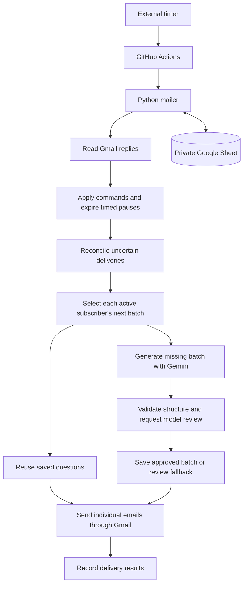

# Interview Practice

**Automated coding interview preparation with AI-generated questions, individual email pacing, and a local Python practice toolkit.**

[](https://github.com/mbaqo/coding_assessments/actions/workflows/checks.yml)

[Quick start](#quick-start) · [Architecture](#architecture) · [Email setup](docs/MAILER.md) · [Website publishing](docs/WEBSITE.md) · [Contributing](CONTRIBUTING.md)

Interview Practice makes a daily coding routine easier to maintain. Each active subscriber receives their next five questions by email. When the saved question sequence runs out, the application automatically asks Gemini to generate and review another batch. Subscribers control delivery by replying with commands such as `PAUSE`, `RESUME`, and `STOP`, while keeping their own place in the curriculum.

The repository also includes a standalone Python CLI for solving exercises, running grading suites, and recording local attempts, plus a static homepage and privacy policy ready for GitHub Pages. The project is designed for a small, invited group, with persistent state and scheduled execution that do not require an always-running application server.

## What it does

| Component | Capabilities |
| --- | --- |
| **Email automation** | Sends five questions per active day, processes subscription commands, and preserves each subscriber’s position independently. |
| **AI question generation** | Creates new batches on demand, validates structured output, requests a second model review, and saves approved questions for reuse. |
| **Local practice CLI** | Lists and filters exercises, displays prompts, grades Python implementations, and optionally records attempts. |
| **Public website** | Explains the service and its data handling through static HTML/CSS pages, with a GitHub Pages deployment workflow. |

**Two kinds of progress are intentionally separate.** The mailer tracks confirmed deliveries and email preferences; it does not collect answers or question-completion data. The local CLI records performance only when the learner explicitly runs `record`. These records are not synchronized with the mailer.

## Independent pacing

Everyone follows the same reusable question sequence, but each person advances through it independently. If two subscribers receive batch 1 and one pauses for two days, the other can continue to batches 2 and 3. When the paused subscriber resumes, they receive batch 2 while the other receives batch 4.

Reply to a practice email with a command on the **first nonempty line**:

| Command | Behavior |
| --- | --- |
| `PAUSE` | Pause indefinitely and keep your place. |
| `PAUSE 7` | Pause for seven days, then resume automatically; durations from 1–365 days are supported. |
| `RESUME` | Continue a paused subscription from its next batch. |
| `STOP` or `UNSUBSCRIBE` | Stop daily delivery until the organizer explicitly reenrolls you. |
| `HELP` | Receive command instructions and subscription status. |

Commands are case-insensitive and processed at scheduled runs. New subscribers start at batch 1. Emails continue without answers, and resuming does not trigger a burst of missed daily emails.

## Architecture



The runtime separates domain logic, orchestration, storage, and API adapters so the full mailing flow can be tested without credentials or network calls.

| Technology | Role |
| --- | --- |
| Python 3.9+ | CLI, scheduling decisions, command parsing, validation, and orchestration. |
| Gemini API | Structured question generation and model review. |
| Gmail API + OAuth 2.0 | Sending individual emails, reading commands, and checking uncertain sends. |
| Google Sheets API | Private persistence for subscribers, commands, batches, and delivery records. |
| GitHub Actions | Serialized mailer execution, CI, and website deployment. |
| External timer, such as cron-job.org | Dispatches the mailer workflow on a daily schedule. |
| HTML/CSS + GitHub Pages | Public homepage and privacy policy. |

The deployed Python runtime and test suites use the standard library. Only interactive OAuth setup requires `google-auth-oauthlib`.

### Automatic question supply

Each run checks whether the next batch needed by a subscriber already exists. Saved batches are reused; reaching the end of the sequence triggers generation automatically. Questions are stored in the private Sheet, so daily operation does not require a developer session or new repository exercise files.

Generation uses at most one draft call and one review call per calendar day for the group. The application checks the five-question schema, difficulty mix, required fields, and recent title/prompt duplicates before requesting a separate model review. The default sequence progresses through foundations, core patterns, trees and search, advanced patterns, and mixed practice, with 14 fresh batches per stage.

If generation fails or review rejects the batch, the mailer sends five saved review questions, using the bundled exercises if necessary. Review emails do not advance mailing position. Generation is attempted again on the next day a new batch is needed.

### Delivery reliability

- **Persist before sending:** Save the batch and delivery intent before calling Gmail, so interrupted runs retain enough state for recovery.
- **Reconcile uncertain results:** Use deterministic message IDs to search Sent mail after timeouts or crashes. An unresolved send holds that subscriber’s sequence instead of blindly resending.
- **Keep retries bounded:** Definite send rejections can retry on a later run. Confirmed daily deliveries are skipped on repeat runs for the same person and date.
- **Process preferences first:** Apply commands before daily delivery. If inbox access, state validation, or persistence fails, stop the run.
- **Serialize state changes:** GitHub Actions permits one mailer run at a time. Local administration must also avoid concurrent writes.

The implementation reduces duplicate delivery risk; it does not claim exactly-once email delivery. An ambiguous result can require organizer review.

### Data handling

Subscriber state stays in a private Sheet. Email addresses, incoming message bodies, and subscription records are not sent to Gemini. The model receives curriculum instructions and previously generated question content. Commands are parsed deterministically by Python, without an LLM.

Replies must match the enrolled sender and a subscriber-specific reply address. Outgoing messages use separate recipient envelopes, and model text is escaped in HTML emails. Scheduled runs log aggregate counts and sanitized errors. The [privacy policy](site/privacy.html) describes storage, provider access, retention, and deletion requests.

## Quick start

Install **Python 3.9 or later**. Offline previews and project checks require no API keys or additional Python packages.

```bash
git clone https://github.com/mbaqo/coding_assessments.git
cd coding_assessments

# Browse the bundled exercises.
python3 practice.py list

# Render a sample email without network access or sending anything.
python3 -m mailer preview

# Verify the local toolkit and mailer.
python3 practice.py check
python3 -m unittest discover -s mailer/tests -v
```

On systems without an IANA timezone database, install `tzdata` for the mailer’s timezone support.

### Practice locally

Open an exercise such as [Contains Duplicate](days/day_01/q01_contains_duplicate.py). Its opening docstring contains the prompt and examples; implement the answer function beneath it, then run the file:

```bash
python3 days/day_01/q01_contains_duplicate.py
```

The repository includes five foundation exercises: Contains Duplicate, Valid Palindrome, Two Sum, Valid Brackets, and Merge Sorted Lists. Their answer stubs intentionally fail until implemented. Each exercise has a separate grading suite, and direct execution runs that suite with a default 30-second timeout.

| Command | Purpose |
| --- | --- |
| `python3 practice.py show 3` | Read a prompt without executing learner code. |
| `python3 practice.py test 3` | Grade one implementation without recording progress. |
| `python3 practice.py test all --day 1` | Grade every exercise in a batch. |
| `python3 practice.py list --topic two-pointers` | Filter exercises by topic. |
| `python3 practice.py status` | View the latest recorded attempt for each exercise. |

To save an attempt explicitly:

```bash
python3 practice.py record 1 --minutes 18 --hints 0 --confidence 4 --notes "Missed the empty-input case"
```

`record` grades the implementation and appends the outcome to `progress.json`, including failed attempts. Writes use atomic file replacement and preserve existing history. Test execution alone never changes progress. Local exercise batches are added through the [authoring workflow](CONTRIBUTING.md); AI-generated email batches remain in the Sheet and do not automatically become runnable exercises.

### Enable email delivery

Follow the [mailer setup guide](docs/MAILER.md) to configure:

1. A sending Gmail account, Gmail/Sheets APIs, and OAuth credentials.
2. A private state spreadsheet and invited subscriber addresses.
3. A Gemini API key and the project’s free-tier configuration acknowledgment.
4. GitHub Actions secrets and the `MAILER_ENABLED` repository variable.
5. An external timer that dispatches the mailer workflow.

The mailer workflow uses `workflow_dispatch`; it does not contain a native cron trigger. The external timer must be configured for unattended operation. Recipients do not authorize Google access or create accounts. In the current implementation, their addresses must differ from the sending account.

[Mailer configuration](mailer/config.example.json) controls timezone, send time, stage length, subscriber cap, and model. Defaults are 08:15 in `America/Los_Angeles` with a cap of 25 non-stopped subscribers. These are configuration limits, not a production capacity claim.

### Publish the website

The `site/` directory contains the homepage, privacy policy, and shared stylesheet. The Pages workflow publishes only that directory. Follow the [website publishing guide](docs/WEBSITE.md) to enable GitHub Pages and use the deployed URLs in Google OAuth Branding.

## Testing and validation

The current suite contains **92 automated tests**: 54 mailer tests and 38 local-toolkit and grading-verification tests. CI is configured to run the checks on Python 3.9 and 3.12, plus an offline email preview.

Coverage includes:

- A simulated 35-day mailing schedule, independent pauses, curriculum progression, and automatic recovery after generation outages.
- Command parsing, sender/token matching, timed pauses, reenrollment, and stale-reply handling.
- Provider failures, interrupted sends, reconciliation, storage corruption, and repeat-run behavior.
- Prompt extraction, catalog validation, CLI filters, subprocess timeouts, and atomic attempt-history writes.
- Reference solutions passing the exercise suites and representative incorrect implementations being rejected, including boundary, exhaustive small-input, and deterministic generated cases.

Tests use fake providers and temporary state. `practice.py check` verifies the project without requiring completed learner solutions. Model review is not an execution-based proof that generated questions are correct, and grading tests do not prove algorithmic complexity.

## Repository structure

```text
mailer/
  domain.py              Subscription rules, curriculum, parsing, and rendering
  engine.py              Run orchestration and delivery recovery
  generation.py          Structured generation, review, and fallback
  providers.py           OAuth, Gmail, and Gemini API adapters
  storage.py             Validated Google Sheets persistence
  __main__.py            Setup, administration, preview, and run commands
  tests/                 Domain, provider, and orchestration tests
practice.py              Local practice CLI and exercise runner
progress.json            Local attempt history
days/                    Bundled exercise files, catalogs, and grading suites
tests/                   CLI tests and grading-suite verification
templates/question/      Templates for adding local exercises
site/                    Public homepage, privacy policy, and CSS
docs/                    Design, deployment, and operations guides
.github/workflows/       Project checks, mailer execution, and Pages publishing
```

## Documentation and scope

- [Mailer setup and operations](docs/MAILER.md): credentials, enrollment, scheduling, and recovery procedures.
- [Website publishing](docs/WEBSITE.md): GitHub Pages deployment and OAuth branding URLs.
- [Local toolkit design](docs/DESIGN.md): exercise format, grading, persistence, and validation decisions.
- [Curriculum](CURRICULUM.md): topic progression and guidance for expanding local practice.
- [Contributing](CONTRIBUTING.md): exercise contracts, templates, and verification requirements.

This project supports a small mailing list and local Python practice. It does not include public signup, instant reply webhooks, automated assessment of emailed answers, or a sandbox for untrusted code. Daily operation depends on configured credentials, scheduling, and provider availability; saved review questions preserve supply during generation failures but may repeat earlier content.
